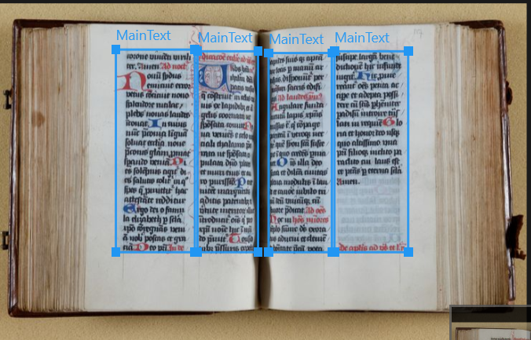

# Ground Truth Conventions Version 0.1

## Introduction

These conventions define how Ground Truth for the Voicing the Document project is created, reviewed, and corrected. They are intended primarily for annotators working with scans of historical documents. The conventions describe how data is selected, how different page elements should be identified and classified, which labels should be assigned to them, how bounding boxes and other spatial information should be created, how reading order and relationships between elements should be represented, and how textual content should be transcribed. They also include conventions for specific document elements such as tables, images, marginalia, page numbers, stamps, and damaged or unclear text, as well as rules for structured output and the handling of uncertain or unresolved cases.

The purpose of these conventions is to ensure that annotations are as consistent and reproducible as possible: different annotators should, in principle, make the same annotation decisions when presented with the same page and task. The resulting Ground Truth will be used to train and evaluate AI models that identify and describe the textual, visual, and structural characteristics of historical documents. Cases that cannot yet be resolved consistently are documented as unresolved questions rather than decided individually by annotators.

## Data selection

The Ground Truth dataset should be based on a sufficiently broad and representative selection of historical document scans. The aim is to expose the model to variation in period, document type, layout, handwriting or print, and structural elements, while also ensuring that less common but important elements are represented in the training data. The project focuses primarily on Dutch historical material from the Middle Ages, Early Modern Period, and Modern Period. Material in other languages may be added where relevant and available.

__Initial data selection__

In the first phase, pages are selected broadly from the available collections \[*__what are the available collections?__*\] rather than only choosing pages that contain elements we already expect to be useful. The purpose of this initial selection is to:

- capture the natural variation present in the collections;
- avoid building the dataset only around obvious or visually interesting examples;
- identify document features or annotation problems that we did not anticipate beforehand;
- test whether the conventions work across different document types and periods.

Where random sampling is used, it should be understood as random sampling within the collections available to the project, rather than as a perfectly random sample of all historical documents.

__Targeted selection__

A broad initial sample alone is unlikely to contain enough examples of every element that the model needs to learn. Rare or unusual features such as tables, marginalia, stamps, damaged text, unusual layouts, decorated initials, or other less common elements may occur too infrequently. After the first broad selection, additional pages should therefore be selected deliberately to address gaps in the dataset.

__Creating Ground Truth from the selected data__

In the initial phase the model is based on a zero-shot setting: the model is asked to perform the annotation task before it has been fine-tuned on Ground Truth created specifically for the Voicing the Document project. The resulting model output serves as a first annotation proposal.

Student assistants then review this output and correct it according to the conventions. This includes, where necessary:

- adding elements that the model has missed;
- removing elements that should not have been annotated;
- correcting labels;
- correcting bounding boxes;
- correcting transcription;
- correcting reading order or structural relationships;
- correcting the required structured output.

The corrected annotation becomes Ground Truth only after it satisfies the project conventions and the required quality-control procedure (see __Evaluation__).

__Documentation of selected data__

For each dataset or batch, the selection process should be documented. At minimum, this should record:

- the source collection;
- the historical period;
- the language, where known;
- whether the pages were broadly/randomly or deliberately selected;
- the reason for targeted selection, where applicable;

#### Unresolved questions

## Prompts

Prompts used for creating Ground Truth and training the model should be designed to elicit a clearly defined and reproducible output from a historical document image. A prompt consists of the input image (a scan of a page from a historical document before 1886 CE), an instruction (for example: “assign bounding boxes to all elements on this page”) and a specification of the expected output. Additional context, such as label definitions, examples, or task-specific instructions, may be included when this is necessary to make the intended interpretation of the task explicit (see section __Labels__).

The image provided with the prompt is a scan of a page from a historical document. The prompt defines the task to be performed on that image, for example identifying all page elements, assigning labels and bounding boxes, determining reading order, transcribing text, or identifying a specific type of element. The expected output should be described explicitly, including both the information that should be returned and the format in which it should be represented, such as JSON or another structured format (see __Intermediate Formats__).

During Ground Truth creation, we may use relatively elaborate prompts that contain detailed instructions, label definitions, reading order and other contextual information. The purpose of these prompts is to make the intended output as explicit as possible and to generate high-quality and consistent responses that can be corrected and used as training data. As the model is fine-tuned, the aim is for it to learn these conventions so that similar results can eventually be produced from shorter and less detailed prompts.

In addition to the task-specific prompt, the model may receive a system prompt containing general instructions that apply across multiple tasks. The system prompt can define overall behavior, terminology, output requirements, or other project-wide rules. Because changes to the system prompt may influence the model’s responses, the version of the system prompt used during Ground Truth creation will be documented and kept consistent within a dataset or experiment.

Training prompts may contain information that researchers are not expected to specify themselves, such as the complete set of available labels and their definitions. In addition to these comprehensive training prompts, we should test shorter and more targeted prompts that reflect likely research use cases. These may, for example, ask the model to locate a particular type of element on a single page or to identify the same type of element across multiple pages (‘bulk chat’).

If a prompt requests an element that is not present in the supplied image, the model should not invent an answer. For structured tasks, it should return a valid empty response in the requested output format. For example, a request to identify tables on a page without a table should return an empty table result rather than an error or a fabricated table. If a conversational interface is used, an explanatory message may additionally state that no matching element was found.

For every prompt type used in Ground Truth creation, we should document its purpose, input, instruction, expected output, and relevant context. Changes to prompts that materially affect the resulting annotations should also be recorded. This makes it possible to understand how the Ground Truth was created and to compare the effect of different prompt formulations.

All prompt types used for Ground Truth creation or testing should be documented and versioned. For each prompt version, we record its purpose, general structure, any changes made, and whether those changes noticeably affect the quality or consistency of the model’s responses.

Template:

- Purpose: What task is this prompt intended to train or test?
- Input: What image or set of images is supplied?
- Instruction: What should the model do?
- Context: Which definitions, labels, examples, or hints are supplied, and why?
- Expected output: What information should be returned?
- Output format: How should that information be structured?
- Empty-result behavior: What should be returned if the requested element is absent?
- Prompt/system-prompt version: Which version was used?

For structured-output tasks, the model should return only the requested structured output, without additional explanatory text, unless explicitly specified otherwise.

#### Unresolved questions

## Text

For the purposes of these conventions, *text* refers to written or printed characters that belong to the page being annotated and that may need to be transcribed. Not all textual elements have the same function. We therefore distinguish between main text, other textual elements, and text that does not belong to the page. These distinctions should be reflected in the labels assigned to the elements.

When a transcription is requested, the transcription should reproduce the text as it appears in the document as closely as possible. Unless a project-specific convention states otherwise, transcription should follow the transcription guidelines of the Dutch National Archives. The original spelling, capitalization, punctuation, and word division should therefore be preserved rather than modernized.

__Main text:__

The main text consists of textual elements that form part of the content of the document. This includes headings, titles and subheadings, the main body of the text, and meaningful marginal or interlinear additions such as commentary, glosses or corrections.

Text does not have to be fully legible in order to be recognized as text. If writing is clearly present but is partly obscured by damage, fading, stains, holes or another cause, it should still be identified as text. However, if the AI model cannot transcribe the text reliably because it is damaged, illegible, or otherwise unclear, it should annotate the relevant passage as __\[UNCLEAR\]__. This makes uncertainty in the transcription explicit and transparent.

Initials and drop capitals are considered part of the text to which they belong. They may also be identified separately when they constitute a distinct visual or structural element. For example, a historiated initial at the beginning of *In principio* should still contribute the letter __I__ to the transcription, while the initial itself may also receive its own label. *\[⟶ Or maybe the AI should render the transcription as “\[I\]n principio creavit Deus caelum et terram”? Or only provide the user with the information that the I is a historiated initial if the user specifically asks for this information? Because this is something that the user can probably also see for themself.\]*

__Other textual elements:__

Some written elements are textual, but should not be treated as part of the main text. They should therefore receive an appropriate separate label. This includes later additions to the document, text contained within an image, page and folio numbers, quire marks, non-content marginal writing such as pen trials, signatures, and text appearing in stamps.

A request for all textual elements may include these categories, whereas a request for main text or a conventional transcription may exclude some of them depending on the task. The expected scope should therefore be stated in the prompt.

\[*__insert examples__*\]

__Text that does not belong to the page:__

Visible writing should not automatically be treated as text belonging to the page being annotated. Text from another page should be excluded when it is visible only through bleed-through, through a hole in the page, or because another page is partly visible in the scan.

For instance, in the image below, the identification of textual elements on the page is done correctly. The running title, marginal note, and main text columns have all been identified and assigned a bounding box. In the left margin, some text is visible from the other side of the folio due to the ink bleeding through, but this has not been labeled as text. On the right side of the image, a small section of the next folio is visible; this has not been labeled as text either.

__What about uncertainty?__

The presence of text and the ability to transcribe it should be treated as two separate questions. If an annotator can clearly determine that text is present but cannot read it reliably, the element should still be identified as text.

For transcription, a best reading should be provided when the characters can be identified with reasonable confidence. If the text cannot be read reliably, it should be explicitly marked as unclear rather than guessed or silently omitted. Following the National Archives convention, we will label and mark unreadable characters as \[__UNCLEAR\]__.

We still need to define the difference between:

- text that definitely exists but cannot be read;
- partially legible text;
- uncertain transcription;
- uncertain label⟶ move to label/quality control
- uncertain bounding-box boundary⟶ move to bounding boxes
- content in an unknown language/script;

#### Unresolved questions

What about (interlinear or marginal) corrections consisting of a couple of letters?

## Reading Order

Reading order describes the sequence in which textual regions or elements on a page should be read when they need to be represented as a linear sequence. Because the visual organization of a historical document cannot always be represented adequately in one sequence, these conventions distinguish between a standard linear reading order and structural relationships between elements.

__Definitions__

Standard linear reading order: The default sequence used when the contents of a page must be represented as one continuous reading sequence.

Structural relationship: A relationship between two or more elements that cannot be expressed adequately by their position in a linear sequence. For example, a marginal note may comment on a particular passage, a caption may belong to an image, or an answer may correspond to a particular question.

Alternative reading order: A reading sequence requested for a particular research purpose that differs from the standard linear reading order. For example, a researcher may wish to read only the main text, to place all marginalia after the main text, or to represent questions and answers as pairs.

__Standard linear reading order__

Text is normally read from left to right and from top to bottom. Headings and subheadings should be read before the text to which they belong. When the main text is divided into multiple columns, each column should normally be read from top to bottom before moving to the next column from left to right.

When a linear reading order is required, the following sequence should be used where applicable. N.b. not every aspect of this list is always expected to be present on the page.

 1. Page or folio number at the top of the page
 2. Running title
 3. First heading or subheading
 4. First section of main text belonging to that heading or subheading
 5. Any marginalia or corrections that clearly relate to that section of the main text
 6. Subsequent heading or subheading
 7. Subsequent main text belonging to that heading or subheading
 8. Any marginalia or corrections that clearly relate to that section
 9. Independent marginalia that cannot easily be linked to a particular passage
10. Page or folio number at the bottom of the page
11. Quire marks or catchwords at the bottom of the page

Steps 6-8 may be repeated as often as necessary when the page contains multiple sections. If a new heading appears partway through a page, the main text preceding that heading should be read before the new heading.

*Examples of pages from historical documents, with annotated reading order, will be added here.*

__Multiple columns__

When the main text is divided into multiple columns, the leftmost column should normally be read first, from top to bottom, followed by the next column to the right. However, physical position alone should not override an obvious logical structure. If the layout clearly indicates that elements should be read in another sequence, that logical relationship takes precedence.

For example, if a document contains questions on the right and corresponding answers on the left, a simple left-to-right sequence may separate questions from their answers. If the relationship between each question and answer is clear, the question and its corresponding answer should be treated as a pair, even when their spatial positions suggest a different sequence.

__Marginalia__

Marginalia should not automatically be inserted into the reading order solely according to their physical position on the page. If a marginal note clearly comments on a specific passage, its relationship to that passage should be recorded. When a linear reading order is required, it should normally follow the passage to which it relates.

If the relationship cannot be determined, the marginal note should be treated as a separate element and placed according to the default sequence above.

__Structural relationships__

Where possible, relationships between elements should be recorded separately from the linear reading order. For example:

- a marginal note comments on region X;
- a caption belongs to image Y;
- a table cell belongs to row X and column Y;
- a continuation follows region Z;
- an answer responds to question X.

The purpose of recording these relationships is to preserve information that would otherwise be lost when the page is converted into a single linear sequence.

__Research specific reading orders__

The standard linear reading order is a default rather than the only valid representation of a page. Researchers may require a different reading order depending on their research question. A prompt formulated by the researcher may therefore explicitly request an alternative reading order. For example, a researcher might request: only the main text, excluding marginalia and page numbers. Or the main text, which is then followed by all marginalia.

__Tables__

Tables should not normally be reduced to a simple left-to-right, top-to-bottom text sequence. Their row and column structure should be preserved. See the section on __Tables__ for the specific convention.

__Exceptions__

Some document types may require a different reading order. Newspapers, forms, question-and-answer layouts, and other visually complex documents may contain blocks whose intended sequence cannot be determined by position alone. These cases should be documented with examples and, where no consistent rule has yet been established, recorded as unresolved cases rather than assigned an arbitrary order.

#### Unresolved questions

Exception: in newspapers, the conventional reading order is sometimes interrupted by a different box of text, or a quotation in a larger font. ⟶ __Some examples__ are needed to illustrate the correct reading order for this.

## Labels

Every annotated bounding box should be assigned a label that identifies the type of element contained within it. Labels are used consistently across the Ground Truth so that the same type of page element is annotated in the same way, regardless of the document in which it appears.

The label set is based primarily on SegmOnto, an existing vocabulary for describing the layout and structural elements of historical documents. (Simon Gabay, Ariane Pinche, Kelly Christensen, Jean-Baptiste Camps, Nicola Carboni, *SegmOnto, A Controlled Vocabulary to Describe the Layout of Pages*, version 0.9 (Genève; Lyon; Paris 2023), <https://segmonto.github.io/>.) Where SegmOnto already provides an appropriate label and definition, this should be used. If a SegmOnto label does not have a sufficiently clear definition for the purposes of this project, the definition may be clarified or expanded. New project-specific labels should only be introduced when no existing label adequately describes the element.

Each label should have a clear definition that explains what the label refers to, what should be included, and, where necessary, what should be excluded. Definitions should be specific enough for annotators to distinguish between similar labels and should be applied consistently throughout the dataset.

Labels may belong to broader zones, such as a main-text zone, marginal zone, or graphic zone. These zones group related types of elements and help describe the overall structure of the page. The relationship between zones and labels should be documented in the label list.

Where possible, the same label set should be applicable to medieval, early modern, and modern historical documents. Differences between document types and periods should preferably be handled through clear definitions and examples rather than by creating separate label systems. If a label is only relevant to a particular type or period of document, this should be stated in its definition.

Some examples have been added below in which the labels are applied to elements in historical sources, which have been assigned bounding boxes. In some examples, bounding boxes have been assigned only to the relevant element; in others, bounding boxes have been assigned to all different elements on the page. Ideally, researchers should be able to choose whether they want to be presented with all bounding boxes at once, or just one element at a time.

__Visualization__

Labels may be displayed using different colors to make annotations easier to distinguish visually. Colors should be assigned consistently, preferably according to the zone to which a label belongs. The color is a visual aid only and is not part of the semantic definition of the label.

| Field        | Entry                                                                                                                                                                                                                                                                                                                                                                                                                                 |
|--------------|---------------------------------------------------------------------------------------------------------------------------------------------------------------------------------------------------------------------------------------------------------------------------------------------------------------------------------------------------------------------------------------------------------------------------------------|
| Zone         | DamageZone:general                                                                                                                                                                                                                                                                                                                                                                                                                    |
| Label        | Damage                                                                                                                                                                                                                                                                                                                                                                                                                                |
| Definition   | __Damage__ is used to describe places where the original source document has been damaged, whether this is due to stains, major discoloration or other causes (except for holes, which have their own label). Ink that has bled through from a different page, but which is still recognizable as text, is not considered damage; neither is minor discoloration or minor blurring of text, which is often a natural effect of aging. |
| Include      | Mold, corrosion, stains, major discoloration, blots, and other forms of damage                                                                                                                                                                                                                                                                                                                                                        |
| Exclude      | Holes, rips, missing corners, minor discoloration, minor (textual) blurring                                                                                                                                                                                                                                                                                                                                                           |
| May overlap? | Yes                                                                                                                                                                                                                                                                                                                                                                                                                                   |
| Example      |                                                                                                                                                                                                                                                                                                                                                                       |
| Source       | Definition based on [SegmOnto](https://segmonto.github.io/gd/gdZ/DamageZone/), with modified wording by VoxDoc.                                                                                                                                                                                                                                                                                                                       |
| Notes        |                                                                                                                                                                                                                                                                                                                                                                                                                                       |

| Field        | Entry                                                                                                                                                                                                                                                                                                              |
|--------------|--------------------------------------------------------------------------------------------------------------------------------------------------------------------------------------------------------------------------------------------------------------------------------------------------------------------|
| Zone         | DamageZone:hole                                                                                                                                                                                                                                                                                                    |
| Label        | Hole                                                                                                                                                                                                                                                                                                               |
| Definition   | __Hole__ is used to describe all areas containing damage to the source in the form of holes of whatever size. Rips, stitched up tears and missing corners are also considered holes in this context. For this label, it does not matter whether the hole was already present when the original source was written. |
| Include      | Holes, tears, rips, repaired rips (with stitches), missing corners                                                                                                                                                                                                                                                 |
| Exclude      | Stains, mold, corrosion, major discoloration, blots and other forms of damage unrelated to holes                                                                                                                                                                                                                   |
| May overlap? | Yes                                                                                                                                                                                                                                                                                                                |
| Example      |                                                                                                                                                                                                                                                      | \
|              |                                                                                                                                                                                                                                                                                                                    | \
|              |                                                                                                                                                                                                                                                    |
| Source       | Proposed subtype by SegmOnto, definition by VoxDoc.                                                                                                                                                                                                                                                                |
| Notes        |                                                                                                                                                                                                                                                                                                                    |

| Field        | Entry                                                                                                                                                                                                                                                                                                                                         |
|--------------|-----------------------------------------------------------------------------------------------------------------------------------------------------------------------------------------------------------------------------------------------------------------------------------------------------------------------------------------------|
| Zone         | DigitizationArtefactZone                                                                                                                                                                                                                                                                                                                      |
| Label        | DigitizationArtefact                                                                                                                                                                                                                                                                                                                          |
| Definition   | __DigitizationArtefact__ is used to describe any type of item added in the scanning process, for digitization purposes, while being unrelated to the historical source document itself. This can be, for example, a ruler, test card or color table. Barcodes are not included in this label, because they are considered a separate subtype. |
| Include      | Rulers, test cards, color targets and other external artifacts                                                                                                                                                                                                                                                                                |
| Exclude      | Barcodes                                                                                                                                                                                                                                                                                                                                      |
| May overlap? | Yes                                                                                                                                                                                                                                                                                                                                           |
| Example      | *To be added.*                                                                                                                                                                                                                                                                                                                                |
| Source       | Definition based on [SegmOnto](https://segmonto.github.io/gd/gdZ/DigitizationArtefactZone/) and modified by VoxDoc.                                                                                                                                                                                                                           |
| Notes        |                                                                                                                                                                                                                                                                                                                                               |

| Field        | Entry                                                                                                                                         |
|--------------|-----------------------------------------------------------------------------------------------------------------------------------------------|
| Zone         | DigitizationArtefactZone:barcode                                                                                                              |
| Label        | Barcode                                                                                                                                       |
| Definition   | __Barcode__ is used as a label for barcodes (or similar tools such as QR-codes) that were added to the image during the digitization process. |
| Include      | Barcodes                                                                                                                                      |
| Exclude      | Rulers, test cards, color targets and other external artifacts                                                                                |
| May overlap? | Yes                                                                                                                                           |
| Example      | *To be added.*                                                                                                                                |
| Source       | Subtype and definition by VoxDoc.                                                                                                             |
| Notes        |                                                                                                                                               |

| Field        | Entry                                                                                                                                                                                                                                                                                                                                                                                                                             |
|--------------|-----------------------------------------------------------------------------------------------------------------------------------------------------------------------------------------------------------------------------------------------------------------------------------------------------------------------------------------------------------------------------------------------------------------------------------|
| Zone         | DropCapitalZone:flourished                                                                                                                                                                                                                                                                                                                                                                                                        |
| Label        | FlourishedDropCapital                                                                                                                                                                                                                                                                                                                                                                                                             |
| Definition   | __FlourishedDropCapital__ is used to describe the first letter of a sentence or section, notably bigger than other letters and surrounded or inhabited by flourishing, which often takes the shapes of thin penwork lines in various shapes and patterns. This zone only encompasses the initial itself, not the rest of the line or section. Drop capitals can be printed, drawn, painted or hand-written, just like other text. |
| Include      | Flourished drop capitals                                                                                                                                                                                                                                                                                                                                                                                                          |
| Exclude      | Historiated drop capitals; illuminations; ornamentation                                                                                                                                                                                                                                                                                                                                                                           |
| May overlap? | Yes                                                                                                                                                                                                                                                                                                                                                                                                                               |
| Example      |                                                                                                                                                                                                                                                                                                                                                    |
| Source       | Subtype suggested by SegmOnto; definition based on [SegmOnto](https://segmonto.github.io/gd/gdZ/DropCapitalZone/) with modified wording inspired by Erik Kwakkel, *Books Before Print* (Leiden 2018), p. 20; and developed for this project by VoxDoc.                                                                                                                                                                            |
| Notes        |                                                                                                                                                                                                                                                                                                                                                                                                                                   |

| Field        | Entry                                                                                                                                                                                                                                                                                                                                                                                                                  |
|--------------|------------------------------------------------------------------------------------------------------------------------------------------------------------------------------------------------------------------------------------------------------------------------------------------------------------------------------------------------------------------------------------------------------------------------|
| Zone         | DropCapitalZone:plain                                                                                                                                                                                                                                                                                                                                                                                                  |
| Label        | DropCapital                                                                                                                                                                                                                                                                                                                                                                                                            |
| Definition   | __PlainDropCapital__ is used to describe the first letter of a sentence or section, which is notably bigger and sometimes more elaborate than other letters, but does not bear any significant decoration such as flourishing or historiation. This zone only encompasses the initial itself, not the rest of the line or section. Drop capitals can be printed, drawn, painted or hand-written, just like other text. |
| Include      |                                                                                                                                                                                                                                                                                                                                                                                                                        |
| Exclude      |                                                                                                                                                                                                                                                                                                                                                                                                                        |
| May overlap? | Yes                                                                                                                                                                                                                                                                                                                                                                                                                    |
| Example      |                                                                                                                                                                                                                                                                                                                                                   | \
|              |                                                                                                                                                                                                                                                                                                                                                                                                                        | \
|              | *Note: the label in this example is not applied correctly. A version with a correct label will be added later.*                                                                                                                                                                                                                                                                                                        |
| Source       | Subtype suggested by SegmOnto; definition inspired by [SegmOnto](https://segmonto.github.io/gd/gdZ/DropCapitalZone/) with modified wording by VoxDoc.                                                                                                                                                                                                                                                                  |
| Notes        |                                                                                                                                                                                                                                                                                                                                                                                                                        |

| Field        | Entry                                                                                                                                                                                                                                                                                                                                                                                                                                 |
|--------------|---------------------------------------------------------------------------------------------------------------------------------------------------------------------------------------------------------------------------------------------------------------------------------------------------------------------------------------------------------------------------------------------------------------------------------------|
| Zone         | DropCapitalZone:historiated                                                                                                                                                                                                                                                                                                                                                                                                           |
| Label        | HistoriatedDropCapital                                                                                                                                                                                                                                                                                                                                                                                                                |
| Definition   | __HistoriatedDropCapital__ is used to describe the first letter of a sentence or section, notably bigger than other letters and surrounded or inhabited by one or more identifiable figures (such as humans, animals, plants or other recognizable elements). This zone only encompasses the initial itself, not the rest of the line or section. Drop capitals can be printed, drawn, painted or hand-written, just like other text. |
| Include      | Historiated drop capitals                                                                                                                                                                                                                                                                                                                                                                                                             |
| Exclude      | Flourished drop capitals; illuminations                                                                                                                                                                                                                                                                                                                                                                                               |
| May overlap? | Yes                                                                                                                                                                                                                                                                                                                                                                                                                                   |
| Example      | *To be added.*                                                                                                                                                                                                                                                                                                                                                                                                                        |
| Source       | Subtype suggested by SegmOnto; definition based on [SegmOnto](https://segmonto.github.io/gd/gdZ/DropCapitalZone/) with modified wording inspired by Erik Kwakkel, *Books Before Print* (Leiden 2018), p. 20; and developed for this project by VoxDoc.                                                                                                                                                                                |
| Notes        |                                                                                                                                                                                                                                                                                                                                                                                                                                       |

| Field        | Entry                                                                                                                                                                                                                                                                                                                                                                                                    |
|--------------|----------------------------------------------------------------------------------------------------------------------------------------------------------------------------------------------------------------------------------------------------------------------------------------------------------------------------------------------------------------------------------------------------------|
| Zone         | DropCapitalZone:decorated                                                                                                                                                                                                                                                                                                                                                                                |
| Label        | DecoratedDropCapital                                                                                                                                                                                                                                                                                                                                                                                     |
| Definition   | __DecoratedDropCapital__ is used to describe the first letter of a sentence or section, notably bigger than other letters and bearing significant ornamentation; for example, a decorated drop capital may be gilded or colored. This zone only encompasses the initial itself, not the rest of the line or section. Drop capitals can be printed, drawn, painted or hand-written, just like other text. |
| Include      | Decorated drop capitals                                                                                                                                                                                                                                                                                                                                                                                  |
| Exclude      | Illuminations, ornamentation, flourished drop capitals, historiated drop capitals                                                                                                                                                                                                                                                                                                                        |
| May overlap? | Yes                                                                                                                                                                                                                                                                                                                                                                                                      |
| Example      | *\[Note: the labels in this image are not completely right; an updated version will be provided soon.\]*                                                                                                                                                                                                                                                                                                 | \
|              |                                                                                                                                                                                                                                                                                                                                                                                                          | \
|              |                                                                                                                                                                                                                                                                                                      |
| Source       | Definition based on [SegmOnto](https://segmonto.github.io/gd/gdZ/DropCapitalZone/) with modified wording by VoxDoc.                                                                                                                                                                                                                                                                                      |
| Notes        |                                                                                                                                                                                                                                                                                                                                                                                                          |

| Field        | Entry                                                                                                                                                                                                                                               |
|--------------|-----------------------------------------------------------------------------------------------------------------------------------------------------------------------------------------------------------------------------------------------------|
| Zone         | GraphicZone:figure                                                                                                                                                                                                                                  |
| Label        | Figure                                                                                                                                                                                                                                              |
| Definition   | __Figure__ characterizes an informative image, such as a diagram, graph or geometrical shape, which is typically printed or drawn rather than painted. A figure typically contains less decoration, color and artistic design than an illumination. |
| Include      | Diagrams, graphs, geometrical shapes and other figures                                                                                                                                                                                              |
| Exclude      | Illuminations, drop capitals, tables                                                                                                                                                                                                                |
| May overlap? | Yes                                                                                                                                                                                                                                                 |
| Example      |                                                                                                                                                                                     | \
|              |                                                                                                                                                                                                                                                     | \
|              |                                                                                                                                                             |
| Source       | Subtype proposed by [SegmOnto](https://segmonto.github.io/gd/gdZ/GraphicZone/), definition by VoxDoc                                                                                                                                                |
| Notes        |                                                                                                                                                                                                                                                     |

|              | Entry                                                                                                                                                                                                                                                                                               |
|--------------|-----------------------------------------------------------------------------------------------------------------------------------------------------------------------------------------------------------------------------------------------------------------------------------------------------|
| Zone         | GraphicZone:illumination                                                                                                                                                                                                                                                                            |
| Label        | Illumination                                                                                                                                                                                                                                                                                        |
| Definition   | __Illumination__ describes a hand-drawn or hand-painted illustration, typically in a medieval manuscript, usually corresponding to the main text. Illuminations can appear with or without use of colored ink. Historiated, decorated or flourished drop capitals are not considered illuminations. |
| Include      | Illuminations                                                                                                                                                                                                                                                                                       |
| Exclude      | Drop capitals, figures, printed images, photographs, ornamentation                                                                                                                                                                                                                                  |
| May overlap? | Yes                                                                                                                                                                                                                                                                                                 |
| Example      |                                                                                                                                                                                                                               | \
|              |                                                                                                                                                                                                                                                                                                     | \
|              |                                                                                                                                                                                                                             |
| Source       | Subtype proposed by [SegmOnto](https://segmonto.github.io/gd/gdZ/GraphicZone/), definition by VoxDoc                                                                                                                                                                                                |
| Notes        |                                                                                                                                                                                                                                                                                                     |

| Field        | Entry                                                                                                                                                                                  |
|--------------|----------------------------------------------------------------------------------------------------------------------------------------------------------------------------------------|
| Zone         | GraphicZone:image                                                                                                                                                                      |
| Label        | Image                                                                                                                                                                                  |
| Definition   | __Image__ describes a printed illustration or picture in a historical document. A photograph and a logo are considered images in this context, but diagrams and other figures are not. |
| Include      | Printed images, photographs, logos                                                                                                                                                     |
| Exclude      | Illuminations, drop capitals, ornamentation, signatures, stamps, seals                                                                                                                 |
| May overlap? | Yes                                                                                                                                                                                    |
| Example      |                                                                                                                         |
| Source       | Subtype proposed by [SegmOnto](https://segmonto.github.io/gd/gdZ/GraphicZone/), definition by VoxDoc                                                                                   |
| Notes        |                                                                                                                                                                                        |

| Field        | Entry                                                                                                                                                                                                                                                       |
|--------------|-------------------------------------------------------------------------------------------------------------------------------------------------------------------------------------------------------------------------------------------------------------|
| Zone         | GraphicZone:ornamentation                                                                                                                                                                                                                                   |
| Label        | Ornamentation                                                                                                                                                                                                                                               |
| Definition   | __Ornamentation__ describes any decorative elements which are separate from illuminations, images, figures or drop capitals, or which extend from an illumination or drop capital into the margins. These elements are often found in the margins of texts. |
| Include      |                                                                                                                                                                                                                                                             |
| Exclude      |                                                                                                                                                                                                                                                             |
| May overlap? | Yes                                                                                                                                                                                                                                                         |
| Example      |                                                                                                                                                                                      |
| Source       | Subtype proposed by [SegmOnto](https://segmonto.github.io/gd/gdZ/GraphicZone/), definition by VoxDoc                                                                                                                                                        |
| Notes        |                                                                                                                                                                                                                                                             |

| Field        | Entry                                                                                                                                                                                                                                                                                                                                                                                                                                                                                                                                                        |
|--------------|--------------------------------------------------------------------------------------------------------------------------------------------------------------------------------------------------------------------------------------------------------------------------------------------------------------------------------------------------------------------------------------------------------------------------------------------------------------------------------------------------------------------------------------------------------------|
| Zone         | MainZone                                                                                                                                                                                                                                                                                                                                                                                                                                                                                                                                                     |
| Label        | MainText                                                                                                                                                                                                                                                                                                                                                                                                                                                                                                                                                     |
| Definition   | __MainText__ is used to describe the original text of a page belonging to a historical source. As a zone, it encompasses the main body of text on a page, which usually appears in the center and fills most of the page. All other elements appearing in this zone, such as headings, drop capitals and interlinear additions, are also encompassed in the MainText bounding box, although they are also assigned their own bounding boxes and labels. When a page is divided into multiple columns, each column is assigned its own MainText bounding box. |
| Include      | paragraphs, continuation text                                                                                                                                                                                                                                                                                                                                                                                                                                                                                                                                |
| Exclude      | headings, marginal notes                                                                                                                                                                                                                                                                                                                                                                                                                                                                                                                                     |
| May overlap? | Yes                                                                                                                                                                                                                                                                                                                                                                                                                                                                                                                                                          |
| Example      |                                                                                                                                                                                                                                                                                                                                                                                                                                                                                                       | \
|              |                                                                                                                                                                                                                                                                                                                                                                                                                                                                                                                                                              | \
|              |                                                                                                                                                                                                                                                                                                                                                                                                                                                                                           |
| Source       | Definition inspired by [SegmOnto](https://segmonto.github.io/gd/gdZ/MainZone/), with modified wording by VoxDoc.                                                                                                                                                                                                                                                                                                                                                                                                                                             |
| Notes        |                                                                                                                                                                                                                                                                                                                                                                                                                                                                                                                                                              |

| Field        | Entry                                                                                                                                                                                                                                                                                                                                                |
|--------------|------------------------------------------------------------------------------------------------------------------------------------------------------------------------------------------------------------------------------------------------------------------------------------------------------------------------------------------------------|
| Zone         | MarginTextZone                                                                                                                                                                                                                                                                                                                                       |
| Label        | MarginText                                                                                                                                                                                                                                                                                                                                           |
| Definition   | __MarginText__ is used to describe all textual elements appearing in the margins above, beneath, between, to the left or to the right of the main text column(s). MarginText has, in principle, been added after the creation of the original writing of the source, often by a different hand. Interlinear additions do not belong to this subtype. |
| Include      |                                                                                                                                                                                                                                                                                                                                                      |
| Exclude      | Page numbers, folio numbers, headings, running titles, quire marks, signatures, interlinear text                                                                                                                                                                                                                                                     |
| May overlap? | Yes                                                                                                                                                                                                                                                                                                                                                  |
| Example      |                                                                                                                                                                                                                                                                                  |
| Source       | Definition inspired by [SegmOnto](https://segmonto.github.io/gd/gdZ/MarginTextZone/), with modified wording by VoxDoc.                                                                                                                                                                                                                               |
| Notes        |                                                                                                                                                                                                                                                                                                                                                      |

| Field        | Entry                                                                                                                                                                                                                                                                                                                                                             |
|--------------|-------------------------------------------------------------------------------------------------------------------------------------------------------------------------------------------------------------------------------------------------------------------------------------------------------------------------------------------------------------------|
| Zone         | MusicZone                                                                                                                                                                                                                                                                                                                                                         |
| Label        | MusicalNotation                                                                                                                                                                                                                                                                                                                                                   |
| Definition   | __MusicalNotation__ is used to describe the presence of any form of musical notation, such as a neume or staff. A musical notation can include text (for example, a song text written below a neume or staff); however, a song text without neume or staff is not considered musical notation, but should be labeled as MainText (or, if applicable, MarginText). |
| Include      |                                                                                                                                                                                                                                                                                                                                                                   |
| Exclude      |                                                                                                                                                                                                                                                                                                                                                                   |
| May overlap? | Yes                                                                                                                                                                                                                                                                                                                                                               |
| Example      |                                                                                                                                                                                                                                                                                          |
| Source       | Definition based on [SegmOnto](https://segmonto.github.io/gd/gdZ/MusicZone/) and expanded by VoxDoc.                                                                                                                                                                                                                                                              |
| Notes        |                                                                                                                                                                                                                                                                                                                                                                   |

| Field        | Entry                                                                                                                                                                                                                                                                                                                             |
|--------------|-----------------------------------------------------------------------------------------------------------------------------------------------------------------------------------------------------------------------------------------------------------------------------------------------------------------------------------|
| Zone         | NumberingZone                                                                                                                                                                                                                                                                                                                     |
| Label        | Numbering                                                                                                                                                                                                                                                                                                                         |
| Definition   | __Numbering__ is used to describe a page number, folio number or document number, usually appearing at the top (often in the external corner) or in some instances at the very bottom of the page. Quire marks (used to denote quire order) and numbers belonging to the headers, marginalia or main text are excluded from this. |
| Include      |                                                                                                                                                                                                                                                                                                                                   |
| Exclude      | Quire marks, marginalia, numbers belonging to headings, numbers belonging to the main text, numbers belonging to dates                                                                                                                                                                                                            |
| May overlap? | Yes                                                                                                                                                                                                                                                                                                                               |
| Example      |                                                                                                                                                                                                                                                                |
| Source       | Definition based on [SegmOnto](https://segmonto.github.io/gd/gdZ/NumberingZone/), modified and expanded by VoxDoc.                                                                                                                                                                                                                |
| Notes        |                                                                                                                                                                                                                                                                                                                                   |

| Field        | Entry                                                                                                                                                                                                                                                                                                                                                                                                       |
|--------------|-------------------------------------------------------------------------------------------------------------------------------------------------------------------------------------------------------------------------------------------------------------------------------------------------------------------------------------------------------------------------------------------------------------|
| Zone         | QuireMarksZone                                                                                                                                                                                                                                                                                                                                                                                              |
| Label        | QuireMark                                                                                                                                                                                                                                                                                                                                                                                                   |
| Definition   | __QuireMark__ is used to describe a signature, catchword or (Roman) numeral, typically appearing at the bottom of the verso side of the final folio of a quire. These marks were added prior to the compilation of the quires of which a historical document is composed, to denote the correct order. Page numbers, folio numbers, document numbers and bibliographic references are not included in this. |
| Include      | Quire marks, quire signatures, catchwords denoting the end of a quire                                                                                                                                                                                                                                                                                                                                       |
| Exclude      | Page numbers, folio numbers, marginal notes, signatures                                                                                                                                                                                                                                                                                                                                                     |
| May overlap? | Yes                                                                                                                                                                                                                                                                                                                                                                                                         |
| Example      |                                                                                                                                                                                                                                                                                                                                          |
| Source       | Definition based on [SegmOnto](https://segmonto.github.io/gd/gdZ/QuireMarksZone/), with modified wording by VoxDoc.                                                                                                                                                                                                                                                                                         |
| Notes        |                                                                                                                                                                                                                                                                                                                                                                                                             |

| Field        | Entry                                                                                                                                                                                                        |
|--------------|--------------------------------------------------------------------------------------------------------------------------------------------------------------------------------------------------------------|
| Zone         | RunningTitleZone                                                                                                                                                                                             |
| Label        | RunningTitle                                                                                                                                                                                                 |
| Definition   | __RunningTitle__ is used to describe the (abbreviated) title of a document or section, appearing outside of the main zone, typically at the top of the page(s). A running title may or may not be decorated. |
| Include      |                                                                                                                                                                                                              |
| Exclude      | Headings, subheadings, page or folio numbers, quire marks, marginal notes                                                                                                                                    |
| May overlap? | Yes                                                                                                                                                                                                          |
| Example      |                                                                                                                                        |
| Source       | Definition based on [SegmOnto](https://segmonto.github.io/gd/gdZ/RunningTitleZone/), with modified wording by VoxDoc.                                                                                        |
| Notes        |                                                                                                                                                                                                              |

| Field        | Entry                                                                                                                                                                                                                                                                 |
|--------------|-----------------------------------------------------------------------------------------------------------------------------------------------------------------------------------------------------------------------------------------------------------------------|
| Zone         | SealZone                                                                                                                                                                                                                                                              |
| Label        | Seal                                                                                                                                                                                                                                                                  |
| Definition   | __Seal__ is used to describe a seal, typically made out of wax, which appears in the historical source. A seal has typically been applied to an area outside of the MainText zone, often at the edge of the page or on a separate ribbon, cord or strip of parchment. |
| Include      | seals                                                                                                                                                                                                                                                                 |
| Exclude      | stamps, illuminations, drop capitals, digitization artifacts                                                                                                                                                                                                          |
| May overlap? | Yes                                                                                                                                                                                                                                                                   |
| Example      |                                                                                                                                                                                                         |
| Source       | Definition inspired by [SegmOnto](https://segmonto.github.io/gd/gdZ/SealZone/) and expanded by VoxDoc.                                                                                                                                                                |
| Notes        |                                                                                                                                                                                                                                                                       |

| Field        | Entry                                                                                                                                                                                                                                                                                                  |
|--------------|--------------------------------------------------------------------------------------------------------------------------------------------------------------------------------------------------------------------------------------------------------------------------------------------------------|
| Zone         | StampZone                                                                                                                                                                                                                                                                                              |
| Label        | Stamp                                                                                                                                                                                                                                                                                                  |
| Definition   | __Stamp__ is used to describe a stamp, for example by a library, archive or postal service, which was often added later than the writing of the original source text. A postage stamp consisting of a small, separate piece of paper to be applied to a letter or envelope is also considered a stamp. |
| Include      | stamps                                                                                                                                                                                                                                                                                                 |
| Exclude      | seals, illuminations, drop capitals, marginal notes, digitization artifacts                                                                                                                                                                                                                            |
| May overlap? | Yes                                                                                                                                                                                                                                                                                                    |
| Example      |                                                                                                                                                                                                                                         |
| Source       | Definition based on [SegmOnto](https://segmonto.github.io/gd/gdZ/StampZone/), with modified wording by VoxDoc.                                                                                                                                                                                         |
| Notes        |                                                                                                                                                                                                                                                                                                        |

| Field        | Entry                                                                                                                                                         |
|--------------|---------------------------------------------------------------------------------------------------------------------------------------------------------------|
| Zone         | TableZone                                                                                                                                                     |
| Label        | Table                                                                                                                                                         |
| Definition   | __Table__ is used to describe text arranged in rows or columns, either with clearly distinct lines, or with implied lines between the rows, columns or cells. |
| Include      |                                                                                                                                                               |
| Exclude      | Figures                                                                                                                                                       |
| May overlap? | Yes                                                                                                                                                           |
| Example      |                                                                                                |
| Source       | Definition based on [SegmOnto](https://segmonto.github.io/gd/gdZ/TableZone/), with modified wording by VoxDoc.                                                |
| Notes        |                                                                                                                                                               |

| Field        | Entry                                                                                                                                                                                                                                                                                                                                                                                                                                             |
|--------------|---------------------------------------------------------------------------------------------------------------------------------------------------------------------------------------------------------------------------------------------------------------------------------------------------------------------------------------------------------------------------------------------------------------------------------------------------|
| Zone         | TitlePageZone                                                                                                                                                                                                                                                                                                                                                                                                                                     |
| Label        | TitlePage                                                                                                                                                                                                                                                                                                                                                                                                                                         |
| Definition   | __TitlePage__ is used to describe a page, typically appearing as the first page or one of the first pages of a document, which is mostly filled by titles or headings, and further bibliographic information such as the author’s name, publisher, printer, date or place. This zone only includes text that was added during the original printing or writing process; later additions, such as librarian’s remarks, do not belong to this zone. |
| Include      |                                                                                                                                                                                                                                                                                                                                                                                                                                                   |
| Exclude      | Marginal text                                                                                                                                                                                                                                                                                                                                                                                                                                     |
| May overlap? | Yes                                                                                                                                                                                                                                                                                                                                                                                                                                               |
| Example      | *To be added.*                                                                                                                                                                                                                                                                                                                                                                                                                                    |
| Source       | Definition based on [SegmOnto](https://segmonto.github.io/gd/gdZ/TitlePageZone/), with modified wording by VoxDoc                                                                                                                                                                                                                                                                                                                                 |
| Notes        |                                                                                                                                                                                                                                                                                                                                                                                                                                                   |

| Field        | Entry                                                                                                                                                                                                                                                                                                                                                                                                                          |
|--------------|--------------------------------------------------------------------------------------------------------------------------------------------------------------------------------------------------------------------------------------------------------------------------------------------------------------------------------------------------------------------------------------------------------------------------------|
| Zone         | CustomZone:folio                                                                                                                                                                                                                                                                                                                                                                                                               |
| Label        | Folio                                                                                                                                                                                                                                                                                                                                                                                                                          |
| Definition   | __Folio__ is used when multiple (partially overlaying) pages or folios are visible in a scan. In such instances, the upper folio which is completely visible should be selected and assigned its own zone. Only elements that fall within this zone should be labeled with their proper zones and subtypes; elements appearing outside of this zone, such as text visible from the other pages or folios, must be disregarded. |
| Include      | The topmost/upper folio or page which is completely visible                                                                                                                                                                                                                                                                                                                                                                    |
| Exclude      | All other (partially) visible pages or folios in the scan                                                                                                                                                                                                                                                                                                                                                                      |
| May overlap? | Yes                                                                                                                                                                                                                                                                                                                                                                                                                            |
| Example      |                                                                                                                                                                                                                                                                                                                                                                 |
| Source       | Definition by VoxDoc                                                                                                                                                                                                                                                                                                                                                                                                           |
| Notes        |                                                                                                                                                                                                                                                                                                                                                                                                                                |

|              | Entry                                                                                                                                                                                    |
|--------------|------------------------------------------------------------------------------------------------------------------------------------------------------------------------------------------|
| Zone         | CustomZone:heading                                                                                                                                                                       |
| Label        | Heading                                                                                                                                                                                  |
| Definition   | __Heading__ describes any kind of heading or subheading not contained within the RunningTitleZone. This can be rubrication, for instance. This zone often falls within the MainTextZone. |
| Include      |                                                                                                                                                                                          |
| Exclude      | Running titles                                                                                                                                                                           |
| May overlap? | Yes                                                                                                                                                                                      |
| Example      |                                                                                                                         |
| Source       | Definition by VoxDoc                                                                                                                                                                     |
| Notes        |                                                                                                                                                                                          |

|              | Entry                                                                                                                                                                                                     |
|--------------|-----------------------------------------------------------------------------------------------------------------------------------------------------------------------------------------------------------|
| Zone         | CustomZone:interlinear                                                                                                                                                                                    |
| Label        | Interlinear                                                                                                                                                                                               |
| Definition   | __Interlinear__ is used to characterize text of whatever length or purpose written between the lines of the main text. It does not matter if this text consists of multiple sentences or just one letter. |
| Include      | All interlinear text                                                                                                                                                                                      |
| Exclude      | Marginal text                                                                                                                                                                                             |
| May overlap? | Yes                                                                                                                                                                                                       |
| Example      | *To be added.*                                                                                                                                                                                            |
| Source       | Definition by VoxDoc                                                                                                                                                                                      |
| Notes        |                                                                                                                                                                                                           |

| Field        | Entry                                                                                                                                                                                                                                                                                         |
|--------------|-----------------------------------------------------------------------------------------------------------------------------------------------------------------------------------------------------------------------------------------------------------------------------------------------|
| Zone         | CustomZone:signature                                                                                                                                                                                                                                                                          |
| Label        | Signature                                                                                                                                                                                                                                                                                     |
| Definition   | __Signature__ describes a hand-written name, sometimes styled in an abstract or decorative way, often appearing below a section of text. Initials used as a replacement for a signature are also signified by this label. A name appearing in the running text is not considered a signature. |
| Include      | Signatures, initials used as signatures                                                                                                                                                                                                                                                       |
| Exclude      | Drop capitals, marginal notes, illuminations, stamps, seals                                                                                                                                                                                                                                   |
| May overlap? | Yes                                                                                                                                                                                                                                                                                           |
| Example      | *To be added.*                                                                                                                                                                                                                                                                                |
| Source       | Definition by VoxDoc.                                                                                                                                                                                                                                                                         |
| Notes        |                                                                                                                                                                                                                                                                                               |

#### Unresolved questions

Should drop capitals which don’t have flourishing, historiation or decoration be labeled DropCapitalZone:plain or just DropCapitalZone?

Should date and place, when written down near a signature, be included in the Signature-bounding box? And if a handwritten name has clearly been added at a designated place in a (printed, formulaic) text at a later point, should this be labeled a Signature?

Are bibliographic references, such as titles or shelfmarks written in the margins of a historical document by a modern librarian or archivist, also considered MarginText? Or should these get their own subtype?

Do we want a label for elements belonging to the codicological context of the source? For example, a piece of ribbon used to keep the pages together?

## Bounding Boxes

Elements that are included in the Voicing the Document label set should be assigned a rectangular bounding box and an appropriate label. A bounding box should be drawn as tightly as possible around the element while still containing the entire element.

Bounding boxes may overlap or be contained within other bounding boxes when different annotations describe different structural levels of the same page area. For example, a decorated or historiated initial may receive its own bounding box while also being contained within the bounding box of the main text region.

__Text regions and columns__

The main body of text should be represented by a MainZone bounding box and assigned the label MainText. If the main text is divided into multiple columns, each column should receive its own MainZone bounding box with the label MainText. Sections within the same column, such as passages separated by subheadings or rubrication, should normally remain within the same MainZone rather than automatically receiving separate main-zone boxes.

The label identifies the type of element contained in the bounding box, while the zone determines the color used to visualize that bounding box. In this case, the element is labeled MainText, and its display color is determined by the color assigned to MainZone.

Marginalia should be treated as separate regions rather than being incorporated into the main-text bounding box. Bounding boxes around marginalia should also minimize unnecessary whitespace.

__Nested and overlapping bounding boxes__

Overlap should be used deliberately rather than accidentally. It is acceptable when two boxes represent different structural levels or different elements occupying the same area. For example, an initial may be annotated separately while remaining part of the larger main-text region. Where two boxes represent independent neighboring regions, unnecessary overlap (i.e. the AI gets confused about whitespace) should be avoided.

__Content that does not belong to the page__

Text or other elements belonging to another page should not receive bounding boxes for the current page. This includes content visible because another page appears partly in the scan or because text from another side or page is visible through the material.

__Cropped elements__

If an element genuinely belongs to the page but is partly cropped by the scan, the bounding box should contain the visible portion of the element.

__Rotated or irregular elements__

Bounding boxes remain rectangular even when the element itself is rotated or irregularly shaped. The box should contain the full visible element as tightly as the rectangular format allows.

In some instances, it is acceptable to assign multiple bounding boxes to one large element to capture its shape; for example, in the case of ornamentation as seen below:

This is what the entire scan looks like with proper segmentation:

Another example of a properly segmented scan:

#### Unresolved questions

We still need to define explicitly: Image size, terugscalen. Linksboven is 0,0

- coordinate system;
- whether coordinates are pixels or normalized;
- \[x1, y1, x2, y2\] versus another representation;
- whether borders themselves count;
- multi-column text;
- whether one text column = one region or paragraphs = separate regions.

How do we treat interlinear additions or corrections? They naturally become part of the MainZone, but should they get their own bounding boxes as well? I would propose not to assign bounding boxes to interlinear additions, to avoid an overwhelming amount of bounding boxes, but if the AI model is asked to generate a general description of the image, it should include a remark about the presence of interlinear additions or corrections. ⟶ overlappende boundingbox⟶ subcategorie toevoegen labels. apart annoteren. vragen aan onderzoekers

The same remark goes for elements such as folds (in letters) or lines drawn by scribes; I would propose not assigning these elements bounding boxes, but instructing the AI to include these in a written description of the page.

In the image below, one of the letters of the running title extends quite far below its baseline; should this letter be contained within the bounding box in its entirety?

*Unnecessary whitespace should be minimized. However, the bounding box should not cut off part of the element simply in order to make the box smaller. If an element has an irregular shape, protruding letters, descenders, or decorative extensions, these should therefore normally remain inside the bounding box.*

## Intermediate Formats

The information extracted by the AI needs to be represented in a structured format before it can be incorporated into the project's final document representation. We therefore use an intermediate format between the AI model's output and PageXML.

PageXML is the project's intended interoperable format for storing structural and textual information about historical documents. It is widely used in document-processing workflows and is also the format used by Loghi. However, PageXML contains more structure and technical information than is necessarily useful for direct interaction with an AI model. An intermediate format should provide a simpler representation of the information relevant to the task while still containing enough information to be converted into PageXML afterwards.

__Why not use PageXML directly?__

Although PageXML is the project's target format, asking the model to produce PageXML directly would tend to make the task harder, without clear benefit for the model itself. PageXML typically encodes a deep hierarchy of regions, lines, and words together with a large amount of technical metadata (geometry, confidence values, provenance information) that the model does not necessarily need to determine in order to answer a research question. The richer the format, the larger the space of possible outputs the model has to learn, the harder it is to check whether a response is well-formed, and the more likely the model is to produce output that is subtly invalid. A simpler, task-focused intermediate format should keep the output space small enough that the model can learn it reliably and that its responses can be validated automatically, while still retaining all of the information that is needed to reconstruct a PageXML representation afterwards. The conversion from the intermediate format to PageXML can then be handled by a deterministic program, which should keep the model's task simple and the PageXML generation reproducible and reliable.

### Formats under consideration

#### DocLang

DocLang is an open, AI-native document format (maintained under the Linux Foundation) that is designed for language models to read and produce directly. It is XML-based and comes with a formal schema, which means that a model response can generally be checked automatically for validity and that the model can even be constrained during generation to emit only well-formed documents. It is simpler than PageXML, but more structured than JSON or Markdown.

#### JSON

JSON is a generic structured format that is widely supported and easy for models to produce. A response can be validated against a JSON schema in the same way as a DocLang response. However, JSON is not a document standard: the project would have to define its own schema for elements, labels, positions, and relationships.

#### Markdown

Markdown is a lightweight markup format that is human-readable and easy for models to produce. However, it is designed for linear text rather than for the two-dimensional layout of a document page. Bounding boxes, labels, and the structural relationships between elements cannot be represented in it in a clean way, so converting a Markdown response to PageXML would lose information.

#### PageXML (directly)

Using PageXML directly would remove the conversion step entirely. However, for the reasons given above, its richer technical structure would tend to make it harder for the model to produce valid output and harder to validate, which is why an intermediate format is generally preferred.

#### Unresolved questions

- Which of the formats under consideration should the project standardize on?
- How lossless must the conversion from the intermediate format to PageXML be?
- What sort of intermediate format do we input to the model if necessary?

### Tables

Tables should be identified as distinct structural elements of a page and should be represented as tables rather than flattened into ordinary running text. A table should receive one bounding box around the entire table and the appropriate table label from the project label set.

The internal structure of the table should be preserved as far as possible. This includes the distinction between rows and columns and, where applicable, between header cells and data cells. Text and numbers contained within the table should be transcribed. When a transcription or structured representation of a table is requested, the output should preserve the relationship between values rather than returning the contents as an undifferentiated sequence of text. The aim is therefore not only to recognize that a table is present, but also to reproduce its structure in a form that can be interpreted by researchers.

__Bounding boxes__

For the first version of the conventions, the table as a whole should receive a bounding box. Whether individual rows, columns, or cells should additionally receive their own bounding boxes has not yet been decided.

__Reading order__

The normal linear reading-order convention should not automatically be applied to tables. The table's own structure determines how its contents should be interpreted. Headers should be associated with the rows or columns to which they belong, and values should remain associated with the correct row and column.

__Empty, merged, and irregular cells__

Empty cells should remain identifiable as \[empty\] rather than causing neighboring values to shift position. Spanning or merged cells should be represented in a way that preserves the fact that they apply to more than one row or column⟶ *__How? Once we find examples, add them. Text over 3 columns, as it didn’t fit.__* diplomatic and expanded transcriptions.

If the structure of a table cannot be reconstructed with sufficient confidence, the model should not invent a structure. The table should still be identified as a table, while uncertainty about its internal structure should be made explicit.

What does a correct table annotation look like?

We have to decide on:

- one outer table as a zone;
- row/column/cell representation;
- header cells versus data cells;
- spanning/merged cells;
- whether lines/borders themselves are elements;
- transcription of cell contents;

#### Unresolved questions

Elements presented as tables are assigned a bounding box labeled ‘Table’. If a page consists of a table in the main text column or block, this is labeled MainText as usual, with an overlapping element labeled Table. But what about when a table covers the entire page? Should it be contained in two bounding boxes of the exact same coordinates, one labeled ‘Table’ and one labeled ‘MainText’? ⟶ I would propose this as a solution, because I believe this is the most consistent approach.

Would this be considered a table?

### Image Descriptions

In these conventions, an image refers to a visual element contained within a historical document page. Visual elements that are included in the project label set should receive their own bounding box and an appropriate label describing the type of image or graphic element. These elements belong to the GraphicZone, which determines the color used to visualize their bounding boxes. The label itself should describe the specific type of element. Images may include, for example, medieval illuminations, engravings, drawings, photographs, diagrams, or other pictorial elements.

When the requested output is structured, images should be treated in the same way as other annotated elements: the output should identify the element, assign the appropriate label, and provide its location. A written description of the image is not required unless the prompt explicitly asks for one.

__Image content__

When a written description of the page or image is requested, the model should provide a concise description of the visible content of the image. The description should be based only on what can reasonably be observed in the scan and should not introduce unsupported interpretations.

__Other/Special elements__

Mathematical formulas require a different representation when converted to PageXML.

#### Unresolved questions

## Test

Testing should be used to determine whether the conventions and the model work across a sufficiently broad range of historical documents and page layouts. Test material should therefore include both broadly selected pages and deliberately selected difficult or unusual cases.

The purpose of testing is to measure whether the model produces the expected output and to determine whether the conventions are sufficiently clear and complete. If a test page reveals a case that cannot be handled consistently using the current conventions, the case should be documented and either added as an example, clarified in the conventions, or recorded as an unresolved question.

#### Unresolved questions

## Evaluation

Evaluation should be carried out throughout the project to assess both the quality of the Ground Truth and the quality of the model output. Ground Truth should be checked for consistency and correctness before it is used for training or evaluation. Model output should be assessed by comparing it with approved Ground Truth and by checking whether it follows the conventions described in this document.

__Ground Truth evaluation__

Ground Truth should be reviewed regularly to ensure that the conventions are being applied consistently. At selected intervals, at least two annotators should independently annotate the same pages and compare their results.

The comparison should consider, where applicable:

- whether the same page elements have been identified;
- whether the same labels have been assigned;
- whether bounding boxes have been placed consistently;
- whether the same reading order and structural relationships have been identified;
- whether textual content has been transcribed consistently;
- whether uncertain or exceptional cases have been handled according to the conventions.

Differences between annotators should be discussed. A disagreement may indicate an annotation error, an unclear convention, or a genuinely ambiguous case. If the same type of disagreement occurs repeatedly, the relevant convention should be clarified and, where possible, supplemented with an example. Ground Truth should only be considered final when the annotation has been reviewed, any known disagreements have been resolved or documented, and the page follows the current version of the conventions.

__Model output evaluation__

Model output should be compared with approved Ground Truth to determine whether the model correctly applies the conventions. The evaluation should consider both completeness and correctness. A response may contain correctly annotated elements while still being incomplete if other required elements are missing.

The following aspects should be evaluated:

- Element detection: Has the model identified all relevant elements, without adding elements that are not present?
- Label assignment: Has each element received the correct label?
- Bounding boxes: Do the predicted boxes correspond sufficiently closely to the Ground Truth boxes?
- Transcription: Is the text reproduced accurately according to the transcription conventions?
- Reading order: Are textual regions placed in the correct sequence where a linear reading order is required?
- Structural relationships: Has the model correctly linked related elements, such as marginalia and the passages they comment on?
- Structured output: Does the response follow the required output format?

__When is an output good enough?__

A model response should be considered acceptable when it contains the information required by the prompt, follows the relevant conventions, and does not contain errors that materially affect the interpretation or reuse of the output. This will be refined as more evaluation data becomes available.

__Periodic evaluation__

Evaluation takes place throughout the annotation and training process. If evaluation reveals a recurring problem, the cause should be investigated. Depending on the problem, this may require:

- improving or expanding the Ground Truth;
- clarifying a convention;
- adjusting a prompt;
- adding targeted training examples.

#### Unresolved questions

- How often should shared annotation/calibration sessions take place?
- How many pages should be independently annotated by more than one annotator?
- What level of annotator disagreement is acceptable?
- What quantitative thresholds should be used for CER, mIoU and label accuracy?
- Should model evaluation be based on one reproducible run per test case, or on multiple runs to account for variation in model output?
- Should different task types have different acceptance criteria?

# AI training

This section describes how the project's AI model is trained. It complements the Ground Truth conventions above, which define how the training data is created and reviewed; here the focus is on the training process itself. The model is a vision-language model: it takes a scan of a document page together with a prompt as input and returns a structured description of the page. Training is done in two stages, pretraining and finetuning, and the training setup is model-agnostic, so the model can be swapped for a newer release without changing the pipeline.

## Pretraining

Pretraining is a supervised fine-tuning (SFT) stage that does not require any data from the student assistants. Instead, it uses training examples generated from the existing PageXML Ground Truth with the project's data-creation tools. Each example pairs a document image with a prompt and the corresponding structured output, so the model learns the task and the structured output format (see __Intermediate Formats__) from material that is already available. Because it relies on existing Ground Truth rather than new annotations, pretraining can start before any student-assistant review has taken place, and it produces the base model on which the finetuning stage builds.

#### Unresolved questions

- How broad should the initial corpus be, and which document types and periods should it cover?
- In this initial phase, should we already try out as many different configurations as possible, or is the main goal to gain a better understanding of the possibilities and the obstacles?

## Finetuning

Finetuning uses the annotated examples that student assistants create by correcting the model's output (see __Creating Ground Truth from the selected data__). It is a sequential pipeline rather than a single mixed run. First, an SFT stage trains on the corrected question-and-answer pairs, teaching the model what a good response looks like. Second, a preference stage aligns the model toward the preferred responses: either DPO, which uses A/B comparisons between two answers, or KTO, which uses unpaired good/bad feedback on individual answers. Third, an optional GRPO stage refines the model further with online reinforcement learning, using reward functions derived from the feedback data. Each stage starts from the model produced by the previous stage, so the pipeline is chained: SFT, then DPO or KTO, then optionally GRPO.

#### Unresolved questions

- Should both DPO and KTO be used, or is one of them sufficient?
- Under what conditions is the optional GRPO stage worth the additional cost?

## Input Format

Each training example combines the document image with the prompt, so the model learns to ground its answer in the scan rather than in text alone. The prompt specifies the task and the expected output, and the model returns the structured output for the page.

#### Unresolved questions

- What is the exact style of prompt used for training, and how does it differ from the shorter prompts that researchers will use?

## Tokens

When the training data is prepared, a decision has to be made about which tokens are kept and which are set aside. This concerns in particular the reasoning tokens that a model may emit alongside its answer: the intermediate steps in which the model works through the page, as opposed to the final structured output. The current idea is that these reasoning tokens are neither corrected by the student assistants nor counted toward the loss during training: the model is trained on the final answer only, while the reasoning that preceded it is left as the model produced it. This should keep the review workload focused on the parts of the output that become Ground Truth. The project nevertheless still wants to explore the use of a reasoning model, so the treatment of reasoning tokens is kept open rather than ruled out.

#### Unresolved questions

- Is the current treatment of reasoning tokens (left uncorrected and excluded from the loss) the right one, and how should the exploration of a reasoning model be carried out?
- Can the model learn to produce its own reasoning tokens without them being explicitly included in the training?

## Evaluation

Evaluation of the model during and after training builds on the evaluation conventions described in the __Evaluation__ section above. In addition to comparing model output with approved Ground Truth, the training process uses an evaluation set that is scored in-loop during training, so the progress of a run can be monitored, and a separate post-training benchmark to compare model versions and track how performance develops over time. The metrics used are character error rate (CER) for the transcription, and mean intersection over union (mIoU) together with label accuracy for the bounding boxes and labels. Because the model is stochastic by design, the same query and scan can yield different outputs on different runs, so it has to be decided whether evaluation is based on a single reproducible run or on multiple runs.

#### Unresolved questions

- Do we use a fixed seed, or multiple runs to account for variation in the model output?

# Bibliography

Gabay, Simon, Ariane Pinche, Kelly Christensen, Jean-Baptiste Camps, Nicola Carboni, *SegmOnto, A Controlled Vocabulary to Describe the Layout of Pages*, version 0.9 (Genève; Lyon; Paris 2023), <https://segmonto.github.io/> (last accessed 6 October 2026)

Kwakkel, Erik, *Books Before Print* (Leiden 2018)

Institut de recherche et d’histoire des textes, *Codicologia* (2011), <https://codicologia.irht.cnrs.fr/colophon> (last accessed 6 October 2026)

# Use of Generative AI in preparing these conventions

Generative AI was used as a writing aid to help structure, formulate, and edit parts of these conventions. The underlying decisions, definitions, examples, and project-specific rules are based on notes, discussions, and decisions made by the Voicing the Document project team. All AI-assisted text was reviewed and, where necessary, revised by the authors.
